<p align="center">
  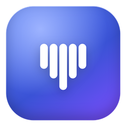
</p>

<h1 align="center">VoxDeck</h1>

<p align="center"><b>Your sounds, in every voice chat.</b><br>
A fast, native soundboard for Windows. Press a key and your friends on Discord hear it too.</p>

<p align="center">
  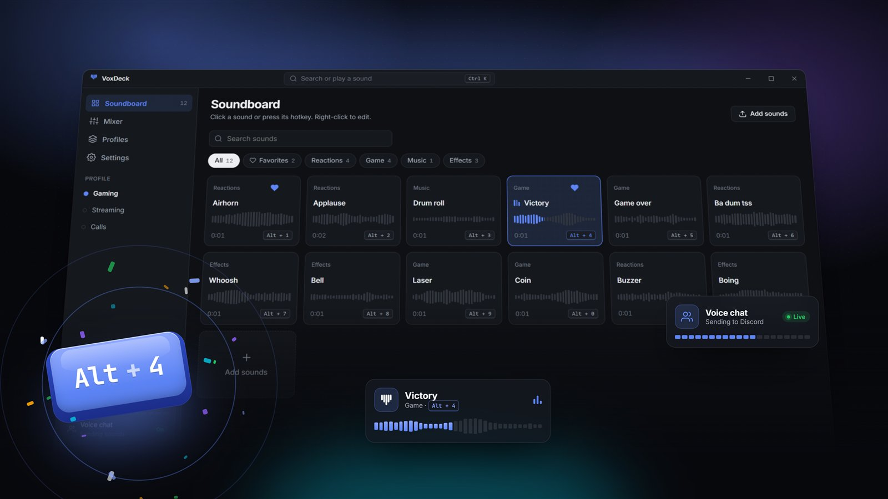
</p>

## Why VoxDeck

- **One key, any game.** Give each sound a global hotkey. It works while a game has the focus.
- **Your friends hear it.** VoxDeck mixes your sounds into your real microphone for Discord, games and calls.
- **Uses the mic you already have.** No new hardware. Your Windows mic settings and enhancements stay as they are.
- **You choose who hears.** Me, Both or Chat, with one switch for every sound.
- **Light and native.** A real Windows app (WPF), not a browser in disguise. Everything stays on your PC: no account, no tracking.

<p align="center">
  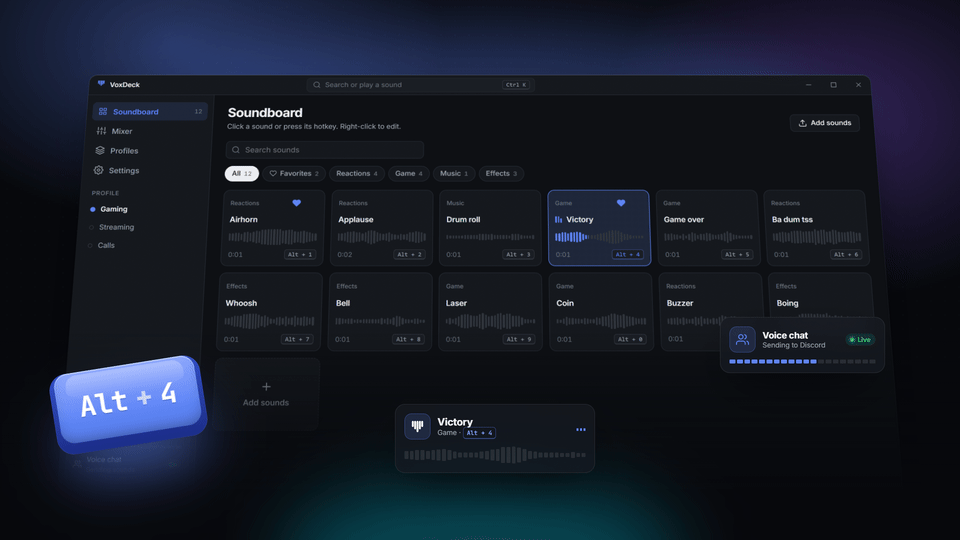
</p>

## How it works

<p align="center">
  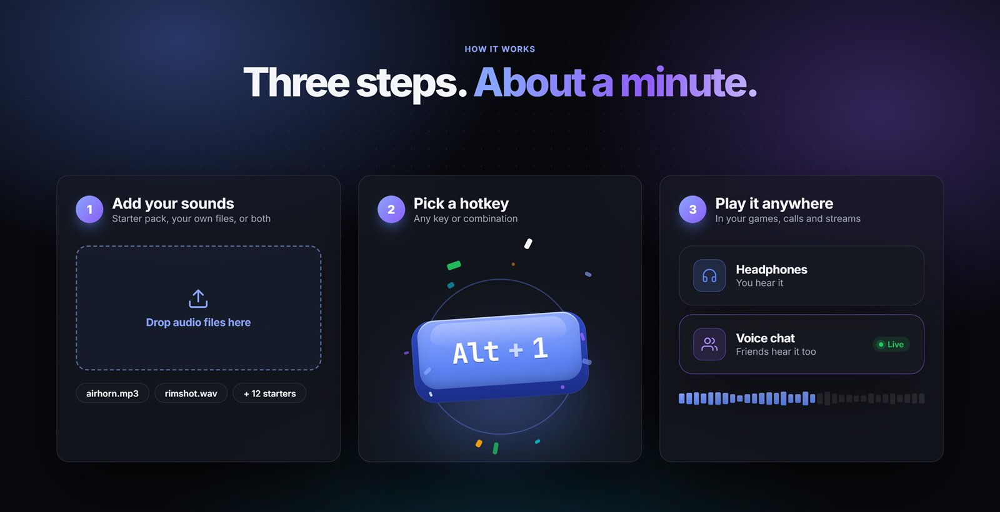
</p>

1. **Add your sounds.** Drop MP3, WAV, M4A, AAC, WMA or FLAC files onto the window. They stay where they are.
2. **Pick a hotkey.** Any key or combination.
3. **Play it anywhere.** Hear it in your headphones, send it to voice chat, or both.

## Features

<table>
  <tr>
    <td width="50%">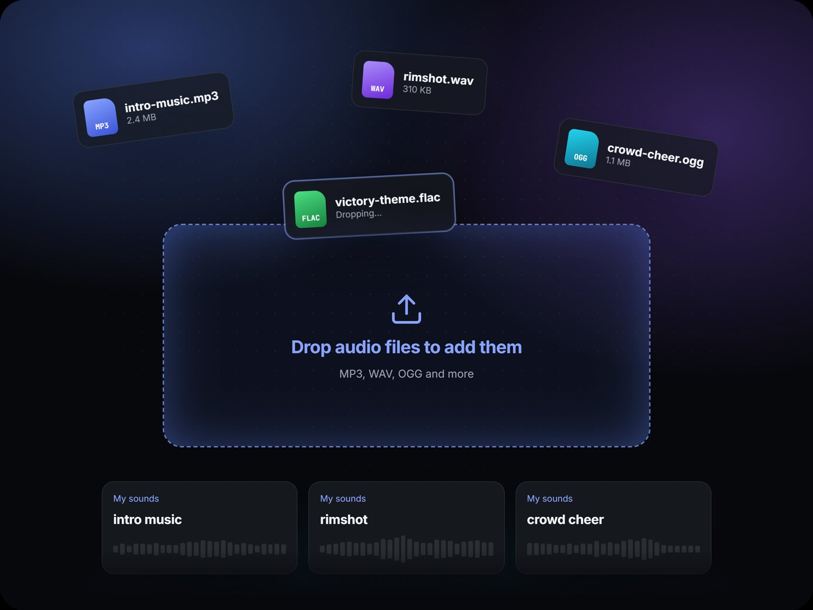<br><b>Library and playlists</b><br>Search, favorites, recent sounds and playlists. Drag a sound onto a playlist to add it.</td>
    <td width="50%">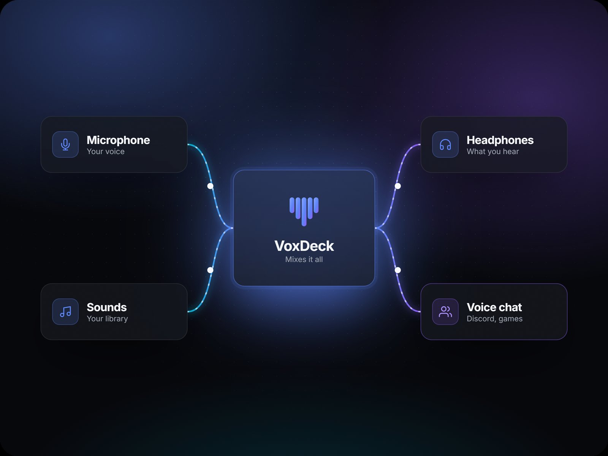<br><b>Voice chat</b><br>Your voice and your sounds go to Discord through a free virtual cable. A limiter keeps it from clipping.</td>
  </tr>
  <tr>
    <td>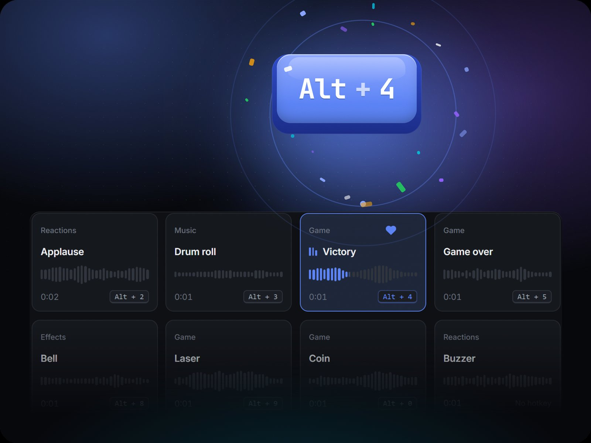<br><b>Global hotkeys</b><br>One key per sound, plus Stop all and Mute mic shortcuts.</td>
    <td>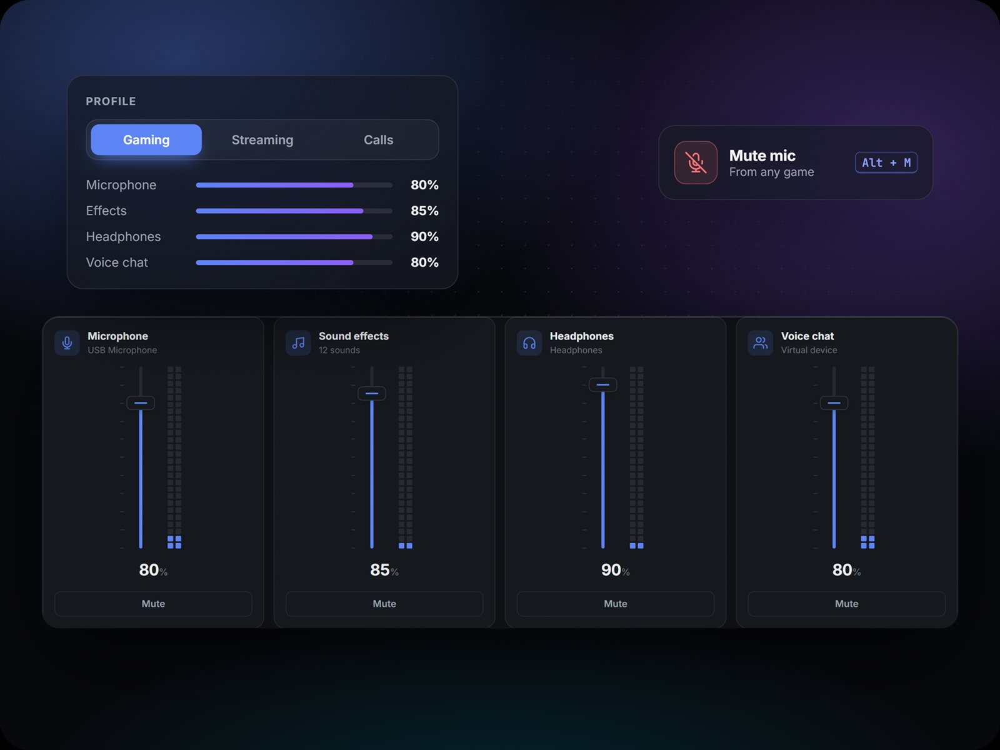<br><b>Mixer</b><br>Separate volumes for your mic, what you hear and what your voice chat hears, with live meters.</td>
  </tr>
  <tr>
    <td>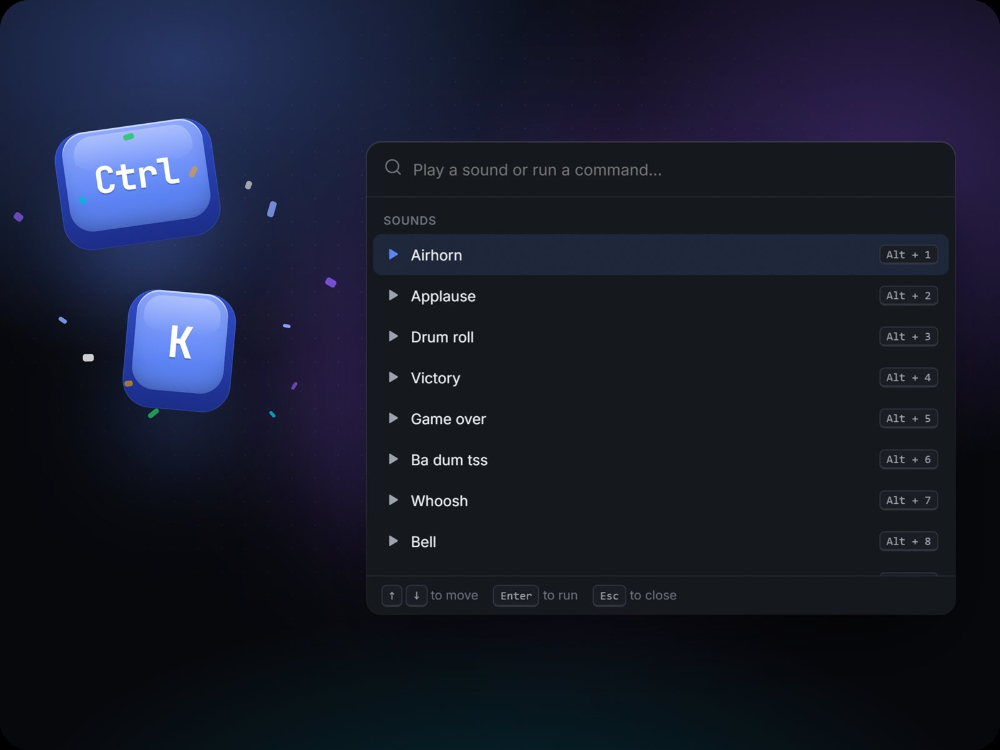<br><b>Ctrl + K</b><br>Find and play any sound, or run any action, from the keyboard.</td>
    <td>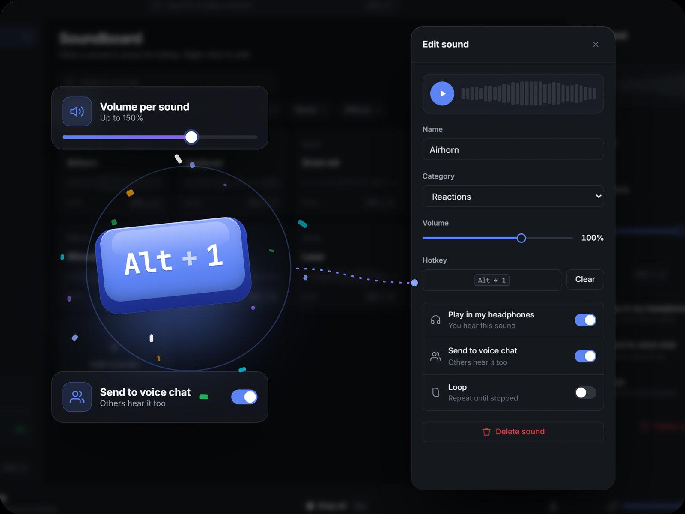<br><b>Sound editor</b><br>Trim the start point, loop, set its own volume, and seek on the waveform.</td>
  </tr>
  <tr>
    <td>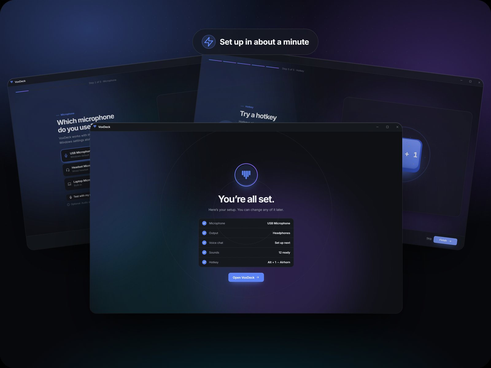<br><b>One-minute setup</b><br>Pick your mic and headphones, add sounds, set a shortcut and turn on voice chat.</td>
    <td>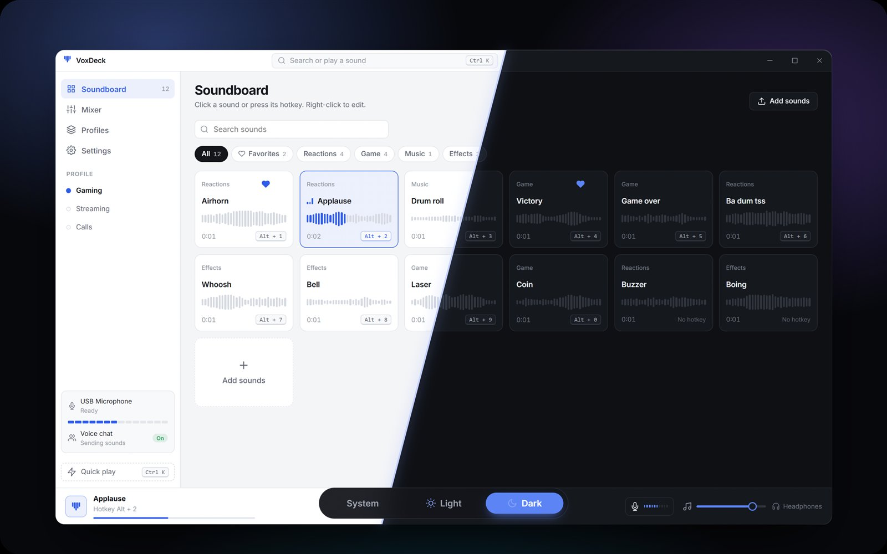<br><b>Light and dark</b><br>Follows Windows, or pick a theme. Smooth motion that turns off with Reduce motion.</td>
  </tr>
</table>

## Download

Get the latest `VoxDeck.App.exe` from the **Releases** page and run it.

- Windows 10 or 11, 64-bit
- [.NET 10 Desktop Runtime](https://dotnet.microsoft.com/download/dotnet/10.0) (Windows asks for it the first time if it's missing)

### Playing sounds in Discord

Discord can only use microphones that Windows knows about. VoxDeck fills a free virtual cable with your voice and your sounds:

1. Install [VB-CABLE](https://vb-audio.com/Cable/) (free) and restart Windows.
2. In VoxDeck, set **Who hears your sounds** to **Both** or **Chat**. Voice chat turns on by itself.
3. In Discord, open **Voice & Video** and pick **CABLE Output** as your input device. Set noise suppression to **Standard** or **None**, because Krisp removes music and sound effects.

VoxDeck never installs drivers by itself. The basic soundboard works without the cable.

## Build from source

```powershell
cd VoxDeck
dotnet test                         # core tests
dotnet run --project src\VoxDeck.App
dotnet publish src\VoxDeck.App -c Release -r win-x64 --self-contained false -p:PublishSingleFile=true -o publish\VoxDeck
```

The app is C# / .NET 10 / WPF with [NAudio](https://github.com/naudio/NAudio).

## Privacy

Your library, playlists and settings live in `%LOCALAPPDATA%\VoxDeck`. VoxDeck has no account, no telemetry and doesn't use the network.
